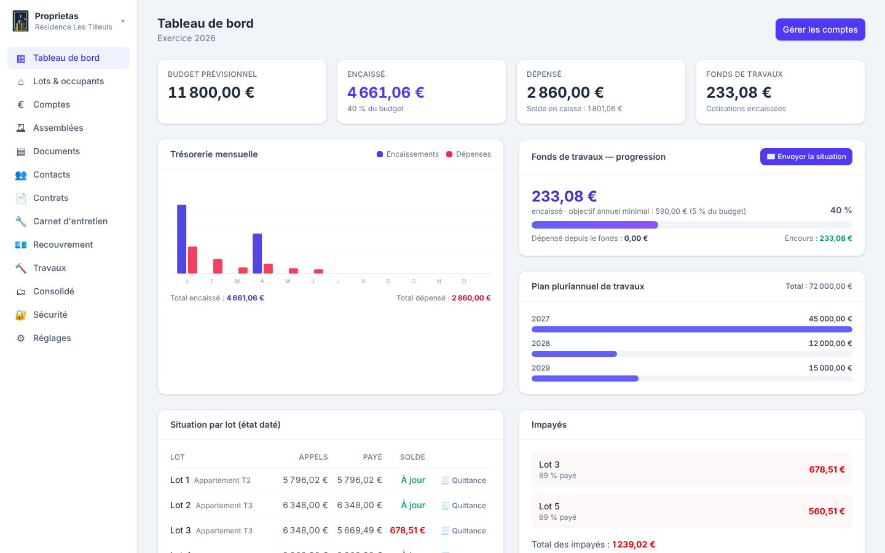

# Proprietas

[](https://github.com/LostInTheBugs/Proprietas/actions/workflows/ci.yml)


> Anciennement **CoproApp**, renommée **Proprietas** en septembre 2026 (nouvelle identité
> visuelle ; le dépôt GitHub devient `LostInTheBugs/Proprietas`, les anciennes URLs redirigent).
> Version courante : **2026.11.054**.



Gestion de copropriété pour syndic bénévole, conçue pour le régime « petite copropriété »
français (art. 41-8 de la loi du 10 juillet 1965, issu de l'ordonnance n° 2019-1101 :
**≤ 5 lots** à usage de logements, bureaux ou commerces, **ou** budget prévisionnel moyen
**< 15 000 €**/an) et **utilisable sans limite de lots** — 12 lots, 15 lots ou plus :
comptabilité simplifiée, consultation écrite, majorités de vote automatiques.

## 🎮 Démo

**https://proprietas.cloudfr.net** (anciennement https://copro.cloudfr.net, conservé) —
un compte de démonstration est préconfiguré avec
deux copropriétés complètes (Paris : 5 lots, comptes 2024-2026, AG + PV, documents,
plan pluriannuel de travaux ; Lyon : 3 lots) :

| Champ | Valeur |
|-------|--------|
| Email | `demo@proprietas.cloudfr.net` |
| Mot de passe | `demo123456` |

Un second compte illustre la vue « copropriétaire » (consultation) : Marie Dubois
possède le lot 1 des Tilleuls et le déclare « propriétaire occupant » (Réglages →
Mes lots), et modifie ses coordonnées (Réglages → Mes informations). Tous les
propriétaires de la démo ont un compte (mot de passe `demo123456`) : `marie.dubois@`,
`jean.martin@`, `sophie.bernard@`, `paul.petit@`, `contact.sci-lilas@`,
`karim.benali@`, `claire.fontaine@`, `enzo.rossi@` (tous en `@example.com`).

| Champ | Valeur |
|-------|--------|
| Email | `marie.dubois@example.com` |
| Mot de passe | `demo123456` |

Le compte démo ne bloque pas l'inscription : le premier compte réel peut toujours
se créer normalement depuis la page de connexion.

## Fonctionnalités

- **Immeuble & lots** : lots, tantièmes (millièmes), propriétaires (des **comptes
  utilisateurs** — « zéro fiche »), **occupation des lots** (« propriétaire occupant »,
  « loué » ou « vacant » — déclarée lot par lot par son propriétaire dans Réglages →
  Mes lots ; aucun nom de locataire enregistré, RGPD)
- **Comptabilité simplifiée** : budget prévisionnel, appels de fonds automatiques par tantièmes,
  encaissements / dépenses, solde par lot, quittances
- **Charges spéciales** (loi du 10 juillet 1965, art. 10) : **clés de répartition** (bâtiment, escalier,
  ascenseur, garages…) avec leurs propres millièmes par lot (page Lots) ; une clé par ligne de budget et par
  dépense commune ; un appel de provisions se partage comme le budget, chaque part par sa clé (ou sur une
  seule clé) ; régularisation clé par clé ; compte de gestion par clé. Une copropriété de plusieurs
  bâtiments s'y ramène : une répartition « entre bâtiments, puis dans le bâtiment » revient à une clé aux
  millièmes recalculés ([#65](https://github.com/LostInTheBugs/Proprietas/issues/65))
- **Factures à payer** : une dépense se saisit « à payer » dès réception de la facture, avec une échéance ;
  elle compte dans les charges mais pas dans la banque jusqu'à « Marquer payée » (par la copropriété, à la
  date du virement, ou de sa poche par quelqu'un : elle devient une avance) ; encart sur le tableau de bord
  du syndic (retards en rouge) et e-mail aux syndics 7 jours avant l'échéance, puis une fois dépassée
- **Avances** : une dépense payée de sa poche par le syndic ou un copropriétaire (« Payée par » sur la
  dépense, **facture obligatoire**, qui ne peut plus être supprimée) compte dans les charges mais pas dans la
  banque ; la copropriété la règle, au choix et même en plusieurs fois, par un **remboursement** (virement :
  sort de la banque, n'est pas une charge) ou en la **déduisant de ses charges** (crédit sur son lot, imputé
  sur ses appels). Jamais plus que le reste dû ; « Avances à régler » dans Comptes, « Mes avances » sur le
  tableau de bord de la personne ; un compte à qui la copropriété doit encore de l'argent ne se supprime pas
- **Banque : relevés et rapprochement** (page Banque, syndic) : import des relevés exportés de la banque en
  ligne — **CSV** (en-tête de la banque, débit/crédit ou montant signé, formats français), **OFX** ou **QIF** —
  pour le compte du syndicat ou celui du fonds de travaux ; « Vérifier » avant d'importer, refus en bloc avec le
  numéro de ligne de chaque erreur, opérations déjà importées jamais ajoutées deux fois (relevés qui se
  chevauchent). **Rapprochement proposé, validé par le syndic** : même sens et même montant à 10 jours près, paiement
  d'un copropriétaire réparti entre ses lots (plusieurs encaissements pour un virement), facture à payer (payée à
  la date du relevé) ; un bouton valide d'un coup les propositions sûres. Ligne sans équivalent : créer la dépense
  ou l'encaissement, ou le paiement d'un copropriétaire, depuis la ligne ; ou la mettre de côté. Opérations
  saisies absentes du relevé signalées. Pas de connexion directe à la banque (agrément DSP2) : l'export suffit
- **Vente d'un lot** (page Lots, syndic) : le lot et ses annexes passent à l'acquéreur à la date de l'acte ;
  **coupure du décompte** (décret du 17 mars 1967, art. 6-2) : appels exigibles et paiements reçus jusqu'à la
  vente restent au **compte du vendeur**, le décompte de l'acquéreur repart de zéro (la régularisation des comptes
  approuvés après la vente lui revient) ; solde du vendeur encaissé après la vente (notaire) porté à son compte ;
  suivi de la notification (art. 6) et de l'avis de mutation, avec l'échéance de l'opposition (15 jours, loi du
  10 juillet 1965, art. 20) ; une vente saisie par erreur s'annule. Documents en PDF : **pré-état daté**
  (informations financières de l'art. L721-2 du CCH, pour la promesse), **état daté** (décret de 1967, art. 5 :
  dû par le vendeur, dû au vendeur, à la charge de l'acquéreur, annexe des deux exercices précédents) et **projet
  d'opposition** (montant et causes, par catégorie de l'art. 5-1) ; les vendeurs qui doivent encore apparaissent
  dans Recouvrement et dans les impayés du compte de gestion
- **Fonds de travaux** : taux configurable (min. légal 5 %), suivi dédié
- **Recouvrement des impayés** : décompte détaillé par provision (imputation FIFO, échu / à
  échoir), relances email, **mise en demeure générée** (PDF), suivi du délai de 30 jours,
  **article 19-2** (exigibilité immédiate des provisions), intérêts au taux légal, frais,
  étapes amiables et judiciaires
- **Assemblées générales** : e-mails d'information (la convocation régulière se notifie par LRE — LRAR si le copropriétaire a demandé la voie postale — ou remise contre récépissé, au moins 21 jours avant) avec un lien personnel « J'ai bien reçu ce message » : le syndic voit qui a confirmé (sans image de suivi ; ce n'est pas un accusé de réception de recommandé), résolutions, moteur de majorités légal
  (art. 24 / 25 / 26, unanimité, régime 2 copropriétaires), procès-verbaux
- **Modifier ou supprimer une AG** (et chaque résolution) : correction de la date, du type, du lieu… ; suppression d'une
  AG saisie par erreur ou d'essai avec tout ce qui en dépend (résolutions, votes, réponses et pouvoirs, votes par
  correspondance, sondage) ; une approbation des comptes votée à cette AG suit sa nouvelle date, ou est retirée
- **Résolutions types de l'AG annuelle** : à la création (ou bouton « Résolutions types »), bureau de séance,
  approbation des comptes de l'exercice écoulé (reliée à l'exercice), quitus, budget de l'exercice suivant
  (montant repris), cotisation au fonds de travaux (art. 25) pré-cochés ; ajustement du budget en cours,
  syndic bénévole, conseil syndical, seuils de l'art. 21 et plan pluriannuel de travaux à cocher si besoin ;
  bonne majorité, texte à compléter
- **Présences et pouvoirs** : chaque copropriétaire répond par le lien de l'e-mail ou depuis son compte
  (« Je serai présent(e) », « … je donne pouvoir à… », « Je ne serai pas présent(e) », « Je ne sais pas
  encore »), jusqu'à l'ouverture de l'AG ; pouvoir à un autre copropriétaire, contrôlé selon l'art. 22 (jamais le
  syndic ; trois pouvoirs au plus par mandataire, sauf sous 10 % des voix), produit en PDF à signer ; le syndic
  voit le tableau, note les pouvoirs signés reçus, corrige en séance et imprime la feuille de présence ; le PV
  indique présents et représentés
- **Vote par correspondance** (loi du 10 juillet 1965, art. 17-1 A ; décret de 1967, art. 9 bis, 14, 14-1 ; modèle de
  l'arrêté du 2 juillet 2020) : formulaires à joindre à la convocation (PDF, un par copropriétaire, téléchargeable aussi
  par chacun depuis son compte) ; le syndic saisit les formulaires reçus au plus tard trois jours francs avant l'AG ;
  abstention ou case vide = vote défavorable ; « pour » sur une résolution amendée en séance = défaillant ; formulaire
  ignoré si le copropriétaire est présent ou représenté ; feuille de présence et PV le mentionnent
- **Vote sur une clé de répartition** (loi du 10 juillet 1965, art. 24, dernier alinéa) : pour les dépenses d'une partie
  de l'immeuble ou d'un équipement, si le règlement le prévoit, une résolution peut être réservée aux lots d'une clé ;
  seuls ces copropriétaires votent, avec leurs millièmes de la clé (majorités calculées sur le total de la clé)
- **Consultation écrite** (régime petite copropriété, unanimité)
- **Documents** : contrats, devis, factures, diagnostics — sur le serveur (dossier local ou S3) ou sur le
  **drive de la copropriété** (WebDAV : Nextcloud, ownCloud, Synology… ; Google Drive), choisi dans Réglages,
  rangés par dossier (Factures, Contrats…) ; sauvegardes chiffrées hebdomadaires sur le drive
- **Messages aux copropriétaires** (page Messages, syndic) : information par e-mail à tous, aux copropriétaires d'une
  clé de répartition ou à une sélection ; un envoi par personne (personne ne voit l'adresse des autres), personnalisé
  ({prenom}, {nom}, {lots}) ; aperçu avant l'envoi, historique ; ce n'est pas une convocation ni une notification
  officielle (le pied du message le rappelle)
- **Contacts** : annuaire des entreprises, fournisseurs et artisans (téléphone, email,
  adresse, site web), recherche, catégories
- **Contrats** : énergie (EDF…), assurance copro, entretien — montant, période,
  renouvellement automatique, fournisseur lié, **échéances suivies automatiquement**
  (alertes J-60, badges Expiré / Expire bientôt, tri par urgence)
- **Carnet d'entretien** : interventions, prestataires, coûts
- **Exports** : registre des copropriétés, compte de gestion annuel, **annexes comptables** 1 à 5 pour l'approbation
  des comptes (décret n° 2005-240 et arrêté du 14 mars 2005 : état financier, compte de gestion général, opérations
  courantes par catégorie — réalisé N-1, budget N, réalisé N, budget N+1 —, travaux et opérations exceptionnelles,
  opérations non clôturées), tirées de la comptabilité de trésorerie ; chaque ligne de budget a sa catégorie de charges
- **Multi-copropriétés** : un compte, plusieurs immeubles isolés, vue consolidée
- **Import des lots** depuis un tableur (CSV, Excel .xlsx, LibreOffice .ods) : numéro, tantièmes, désignation,
  type, surface, propriétaire (e-mail d'un compte) et millièmes de chaque clé de répartition (colonnes « clé :
  Nom ») ; vérification avant import, refus en bloc avec le numéro de ligne de chaque erreur, modèle à
  télécharger (page Lots)
- **Comptes utilisateurs** : les propriétaires sont des comptes (prénom, nom, email,
  téléphone, adresse, rôle, mot de passe) ; chacun modifie ses propres coordonnées
  (Réglages → Mes informations) et déclare l'occupation de ses lots (Mes lots) ;
  suppression confirmée et tracée, historique conservé (relances / convocations / actes)
- **Rôle copropriétaire (consultation)** : les jetons d'écriture (copropriété, fonds de
  travaux, emails, relances, comptes utilisateurs, recouvrement, sécurité) sont refusés
  par l'API ; les écrans correspondants sont masqués — le copropriétaire consulte la
  situation, les assemblées et les documents, et gère ses propres informations
- **Trésorerie visible par tous** : le compte bancaire séparé du syndicat et le compte
  dédié du fonds de travaux s'affichent en lecture seule aux copropriétaires (Réglages →
  Trésorerie de la copropriété), avec les montants portés au crédit selon la comptabilité
  (encaissements − dépenses) — seule la modification reste au syndic
- **Sécurité** : double authentification TOTP (compatible FreeOTP, Aegis, Google
  Authenticator…), codes de secours, réinitialisation assistée par le syndic,
  journal d'audit, alertes email de connexion, historique des connexions (activable) et
  blocage des comptes après des échecs de connexion (Réglages → Sécurité)
- **Thème clair / sombre** : au choix par compte (Réglages → Apparence) — clair, sombre
  ou système (suit l'appareil), appliqué dès le chargement sans clignotement
- **Multi-pays** : module de règles par pays (France en V1, extensible)

## Feuille de route

Pistes retenues pour plus tard, sans date :

- **Charges spéciales en AG** : vote des seuls copropriétaires concernés par une clé de répartition
  (art. 24, dernier alinéa).
- **OneDrive** comme drive de la copropriété (comptes personnels et professionnels), après WebDAV et
  Google Drive.
- **Envoi des lettres recommandées** (électroniques ou papier) depuis l'application : aujourd'hui, elle
  prépare les courriers, le syndic les envoie.

## Stack

- Backend : FastAPI + SQLAlchemy + JWT (Python 3.11)
- Frontend : React + TypeScript + Vite + Tailwind
- Base de données : PostgreSQL (prod) / SQLite (dev)
- Déploiement : Docker Compose + Caddy (TLS auto) — hébergé sur un serveur dédié, derrière Cloudflare

## Développement local

```bash
# Backend (port 8000)
cd backend
python3 -m venv .venv && source .venv/bin/activate
pip install -r requirements.txt
alembic upgrade head            # crée/met à jour le schéma (SQLite dev)
uvicorn app.main:app --reload --port 8000

# Frontend (port 5173)
cd frontend
npm install
npm run dev
```

Premier lancement : créer le compte syndic via `POST /api/auth/register` (ouvert tant qu'aucun utilisateur n'existe).

## Sécurité

- **`COPRO_SECRET_KEY` obligatoire hors dev** : le backend refuse de démarrer
  (hors base SQLite) si la clé de signature JWT n'a pas été définie —
  la valeur par défaut `change-me` est publique et permettrait de forger des
  tokens. Génération : `python -c "import secrets; print(secrets.token_hex(32))"`.
- **Rate limiting sur `/api/auth/login`** : 5 tentatives échouées par email et
  par IP sur 15 minutes, puis `429` (limiteur en mémoire, adapté à une instance
  mono-serveur).
- **Session par cookie `HttpOnly`** : le jeton de session n'est pas accessible au
  JavaScript (rien dans `localStorage`), posé à la connexion — `SameSite=Lax`,
  `Secure` derrière HTTPS, supprimé au logout. Le header `Bearer` reste accepté
  pour l'API/CLI (scripts, tests) ; jamais de jeton dans l'URL (`?token=` refusé) ; les jetons hérités des
  versions précédentes sont migrés automatiquement en cookie au premier
  chargement (aucune reconnexion nécessaire).
- **Upload de documents** : plafond configurable `COPRO_UPLOAD_MAX_MB` (défaut
  25 Mo, `413` au-delà) et liste blanche d'extensions
  (`.pdf .jpg .jpeg .png .doc .docx .xls .xlsx .odt .ods`, `400` sinon).
- **CORS** : liste d'origines configurable `COPRO_CORS_ORIGINS` (JSON).
- **RGPD** : journal d'audit et IP de dernière connexion purgés chaque jour au-delà de
  `COPRO_RETENTION_JOURNAL_MOIS` (défaut 12, 0 = jamais) ; export « mes données » dans
  Réglages ; mot de passe SMTP chiffré en base (clé dérivée de `COPRO_SECRET_KEY` : si elle
  change, ressaisir le mot de passe SMTP).
  Vide en production — le frontend est servi par le même backend. En dev
  (SQLite), `http://localhost:5173` est autorisé automatiquement.
- **Isolation multi-copropriétés** : tout accès par identifiant est scopé à la
  copropriété active du token (404 si l'objet appartient à une autre copro).
- **Double authentification (TOTP, RFC 6238)** : par compte, sans dépendance
  externe — compatible avec toute application d'authentification (FreeOTP, Aegis,
  Google Authenticator…). Codes de secours à usage unique (affichés une seule fois),
  désactivation protégée par mot de passe + code, réinitialisation assistée par le
  syndic (tracée). Politique par copropriété : `off` | `syndic` | `all` — les
  nouvelles copropriétés reçoivent `COPRO_TOTP_DEFAULT_POLICY` (défaut `syndic` ;
  l'app desktop la force à `off`). Le secret TOTP est chiffré en base (clé dérivée
  de `COPRO_SECRET_KEY` : **changer cette clé impose aux comptes de ré-enrôler leur
  2FA**). Les jetons intermédiaires (vérification du code, enrôlement forcé) sont à
  portée limitée et courts (10 / 30 min) ; les tentatives 2FA partagent le
  rate-limit du login.
- **Connexions** (page « 🔐 Sécurité », réglage par copropriété) : par défaut, chaque compte
  ne garde que sa dernière connexion et son dernier échec. L'**historique** activé écrit aussi
  chaque connexion réussie, ratée ou refusée dans le journal d'audit (les copropriétés créées
  avant la 2026.11.039 l'ont activé, comme avant). Le **blocage** (désactivé par défaut) bloque
  un compte 15 min après 5 échecs d'affilée (puis à chaque multiple), et jusqu'au déblocage
  après 10 ; tout est réglable, 0 = jamais de blocage définitif. Les comptes avec double
  authentification n'y sont soumis que si la copropriété le demande, les comptes de
  démonstration jamais ; un compte de plusieurs copropriétés suit la règle la plus stricte.
  Débloquent : le syndic (comptes de sa copropriété), l'administrateur de l'instance
  (Réglages → Serveur → Comptes bloqués) et, en secours, la commande
  `docker compose exec backend python -m app.cli.debloquer adresse@exemple.fr` (`--liste`
  pour les voir). La personne est prévenue par e-mail du blocage et du déblocage. Le
  limiteur par adresse et IP (5 essais en 15 min) reste en plus.
- **Journal d'audit** : connexions (si l'historique est activé), blocages et déblocages, activation / désactivation /
  réinitialisation 2FA, usage des codes de secours, création, modification et
  suppression de comptes, exports (compte de gestion, quittances, rapport annuel,
  CSV, registre) et envois de relances — consultable par le syndic (page
  « 🔐 Sécurité ») pour la copropriété active.
- **Alertes email de sécurité** (best effort, via le SMTP de la copropriété, ou à défaut de l'instance) :
  connexion depuis une nouvelle IP, 2FA désactivée ou réinitialisée, code de
  secours utilisé.

### Données personnelles (RGPD)

Données traitées, bases légales, destinataires, durées de conservation proposées, droits des personnes et écarts connus : [docs/rgpd.md](docs/rgpd.md). Modèle de note d'information à remettre aux copropriétaires : [docs/information-coproprietaires.md](docs/information-coproprietaires.md).

## Recouvrement des impayés

Page « 💶 Recouvrement » (réservée au syndic) : par lot, un dossier suit la
procédure légale — relances email → **mise en demeure** → article 19-2 → amiable →
contentieux.

- **Décompte détaillé** : imputation FIFO des encaissements sur les appels les plus
  anciens ; distinction échu / à échoir. La mise en demeure liste la nature et le
  montant de chaque provision échue impayée (exigence de précision — cf. Cass. 3e
  civ., 18 juin 2026, n° 24-19.950).
- **Mise en demeure (PDF)** : générée depuis le dossier (mentions du compte
  Service-Public F2603 : identité et adresse du copropriétaire, décompte, délai de
  30 jours, conséquences). L'app trace le mode d'envoi et la référence (lettre
  recommandée électronique — la voie électronique est la règle, le papier
  l'exception — ou remise). L'envoi recommandé électronique se fait chez un
  prestataire externe (type AR24) : l'app prépare le courrier, le syndic l'envoie.
- **Article 19-2** : 30 jours après la mise en demeure restée infructueuse, l'app
  calcule les provisions non encore échues de l'exercice + les restes des exercices
  précédents devenus **immédiatement exigibles** (activation assistée, tracée,
  jamais automatique).
- **Intérêts et frais** : taux de l'intérêt légal paramétrable (arrêté semestriel,
  saisi par le syndic — pas de taux inventé par l'app), intérêts courus estimés
  depuis la mise en demeure, frais de recouvrement imputés au dossier (à la charge
  du débiteur).
- **Étapes suivantes** : conciliation / commissaire de justice / saisine du
  tribunal (≤ 5 000 € : règlement amiable obligatoire avant le juge, conciliateur
  gratuit ; le syndic n'a pas besoin d'autorisation d'AG pour le recouvrement ;
  prescription 5 ans).

⚠️ L'application **génère les courriers mais ne fournit pas de conseil
juridique** : faites valider les modèles par un conseil avant usage réel. Le syndic
ne peut pas avancer de fonds au syndicat (art. 18 de la loi du 10 juillet 1965) —
le module n'expose volontairement aucune fonction d'avance.

## Tests

```bash
cd backend
python3 -m venv .venv && source .venv/bin/activate
pip install -r requirements.txt -r requirements-dev.txt
python -m pytest -q            # 139 tests, ~70 % de couverture (pytest --cov)
```

La suite (pytest + TestClient, SQLite en mémoire) couvre : isolation multi-copro,
majorités légales (art. 24/25/26, unanimité, régime 2 copropriétaires, passerelle
25-1), tantièmes et appels de fonds (total ≠ 1000, arrondis au centime), soldes
par lot, authentification (register fermé, login, switch-copro, expiration),
double authentification (enrôlement, connexion en deux étapes, codes de secours à
usage unique, politiques par copropriété, réinitialisation par le syndic), journal
d'audit (droits, isolation inter-copro, pagination), fonds de travaux 5 %,
recouvrement (décompte FIFO et imputation, statuts du dossier, mise en demeure
générée, article 19-2, permissions syndic), thème utilisateur (défaut, mise à
jour, validation, NULL lisible), sessions (cookie HttpOnly, priorité d'auth,
migration, logout), génération PDF (non vide + régression
du compte de gestion) et un flux complet de bout en bout. CI : `.github/workflows/ci.yml` (push + PR).

L'ancien `test_e2e.py` (script urllib contre une instance réelle) vit désormais
dans `backend/scripts/smoke_e2e.py` : conservé comme smoke test manuel d'un
déploiement réel, le parcours équivalent tournant en CI dans `test_flux_complet.py`.

## Applications de bureau (Windows / macOS)

Des versions autonomes (aucun serveur, aucun Docker) sont produites par la CI
(`desktop/`) et jointes à chaque release GitHub :

- `Proprietas-Windows.zip` — double-clic sur `Proprietas.exe` ; données dans le
  dossier `data/` à côté de l'exécutable ;
- `Proprietas-macOS.zip` — double-clic sur `Proprietas.app` (Apple Silicon ;
  premier lancement : clic droit → Ouvrir) ; données dans `data/` à côté de
  l'application (repli : `~/Library/Application Support/Proprietas` si
  l'emplacement est en lecture seule).

Les deux archives incluent le guide utilisateur en FR / EN / DE / LU.
Téléchargement : [dernière release](https://github.com/LostInTheBugs/Proprietas/releases/latest).

## Déploiement

Production : **https://proprietas.cloudfr.net** + legacy **https://copro.cloudfr.net**
(Cloudflare proxy → serveur de production, Caddy TLS Let's Encrypt).

### Profils de déploiement

- **Réseau local** (défaut) : `docker compose up -d` → l'application écoute sur le
  port 8000, accessible depuis votre réseau (aucun domaine requis).
- **Accès depuis internet** : `COPRO_DOMAIN="copro.exemple.fr" docker compose
  --profile internet up -d --build` → ajoute le proxy TLS (Caddy, certificats
  Let's Encrypt automatiques). Plusieurs domaines possibles, séparés par des
  virgules (`COPRO_DOMAIN="copro.fr, ancien.fr"`).

Dans l'application, le profil est affiché et VÉRIFIÉ : 🔐 Sécurité →
« Accès depuis internet » (réservé au syndic) — déclarez où vit l'application,
renseignez l'URL publique puis lancez le **diagnostic** (HTTPS, certificat, DNS,
en-têtes, rate-limit, couverture 2FA). La première requête vue depuis internet est
détectée automatiquement : un bandeau propose l'assistant — une exposition ne peut
pas passer inaperçue.

#### Déploiement chez [Clever-Cloud](https://console.clever-cloud.com/)

Pour déployer chez Clever-Cloud, [Zorglube](https://github.com/zorglube) a rédigé un [petit manuel](https://blog.broncotoxique.com/2026/10/07/deploy-proprietas-on-clever-cloud/).
Attention il s'agit d'un déploiement **Docker** simple, pas **Compose**. 

### Hébergement « maison » (sans ouvrir de ports)

Depuis une connexion personnelle, préférez un tunnel à l'ouverture de ports :
- **Cloudflare Tunnel** : `cloudflared tunnel --url http://localhost:8000` (essai) ;
  en production, un tunnel nommé vers votre domaine (Cloudflare Zero Trust, gratuit
  jusqu'à 50 utilisateurs) ;
- ou **Tailscale Funnel**.

Activez ensuite le durcissement dans 🔐 Sécurité → « Accès depuis internet » et
vérifiez avec le diagnostic.

### Stockage des documents (dossier local ou S3)

Par défaut, les documents déposés vont dans le dossier `COPRO_UPLOAD_DIR` (volume
`uploads` en Docker). Ils peuvent aussi aller dans un **bucket compatible S3** : AWS,
Clever Cloud Cellar, OVH Object Storage, Scaleway, MinIO… — utile quand le disque du
conteneur n'est pas persistant (PaaS) ou pour séparer les fichiers du serveur.

| Variable | Rôle |
|---|---|
| `COPRO_STOCKAGE` | `local` (défaut) ou `s3` |
| `COPRO_S3_BUCKET` | nom du bucket (obligatoire en `s3`) |
| `COPRO_S3_ENDPOINT_URL` | URL du service, vide pour AWS (ex. `https://cellar-c2.services.clever-cloud.com`) |
| `COPRO_S3_REGION` | région, si le service l'exige |
| `COPRO_S3_ACCESS_KEY_ID`, `COPRO_S3_SECRET_ACCESS_KEY` | identifiants ; vides = variables `AWS_*` standard |
| `COPRO_S3_PREFIX` | préfixe des objets (défaut `documents/`) |

Clever Cloud (add-on Cellar) : `COPRO_S3_ENDPOINT_URL=https://<CELLAR_ADDON_HOST>`,
`COPRO_S3_ACCESS_KEY_ID=<CELLAR_ADDON_KEY_ID>`, `COPRO_S3_SECRET_ACCESS_KEY=<CELLAR_ADDON_KEY_SECRET>` ;
créez le bucket avant le premier démarrage.

Le stockage est **vérifié au démarrage** (écriture, relecture et suppression d'un fichier
témoin) : un bucket absent, de mauvais identifiants ou un dossier en lecture seule
empêchent de démarrer, avec un message explicite dans les logs.

**Passer des documents existants vers S3**, sans interruption :

```bash
# 1. Ajouter les variables COPRO_S3_* en laissant COPRO_STOCKAGE=local, redémarrer, puis :
docker compose exec backend python -m app.cli.migrer_stockage --simulation
docker compose exec backend python -m app.cli.migrer_stockage
# 2. Passer COPRO_STOCKAGE=s3, redémarrer, puis relancer pour rattraper les dépôts
#    faits entre-temps (les fichiers déjà copiés, de même taille, sont ignorés) :
docker compose exec backend python -m app.cli.migrer_stockage
```

La commande ne copie que les fichiers référencés en base, ne supprime jamais la source
(gardez le volume `uploads` jusqu'à vérification) et sort en erreur si une copie échoue.
Sens inverse : `--sens s3-vers-local`.

### Drive de la copropriété (Nextcloud, ownCloud, Synology… en WebDAV)

Dans **Réglages → Sauvegarde et stockage → Drive de la copropriété**, le syndic peut brancher un drive
WebDAV : les fichiers déposés ensuite y sont rangés dans un dossier par catégorie, sous un nom lisible —
`Proprietas/<copropriété>/Factures/2026-11-16 Facture d'électricité.pdf` — et ne sont **pas** gardés sur le
serveur. Les fichiers déposés avant le branchement restent où ils sont.

| Service | Adresse WebDAV |
|---|---|
| Nextcloud, ownCloud | `https://cloud.exemple.fr/remote.php/dav/files/<identifiant>/` |
| Synology (paquet « WebDAV Server ») | `https://nas.exemple.fr:5006/` (ou `http://…:5005/` sur le réseau local) |

Le drive doit appartenir à la copropriété : un **compte dédié à l'immeuble** (Nextcloud, Synology, Google…),
jamais le compte personnel du syndic. Au changement de syndic, ce compte est transmis au successeur avec les
archives, et les documents restent à la copropriété.

Utilisez de préférence un **mot de passe d'application** : il est chiffré en base et n'est jamais réaffiché.
Les réglages ne sont enregistrés que si l'essai réussit (dossier créé, fichier témoin écrit, relu, supprimé).

Dans la même carte, une fois le drive branché :

- **Déplacer vers le drive** : les fichiers déposés avant le branchement y sont rangés comme les nouveaux
  (copie, contrôle, puis suppression de l'original : une panne ne perd rien) ;
- **Vérifier le drive** : liste les documents dont le fichier manque. **Retrouver par le contenu** relie
  chacun au fichier du drive qui a exactement le même contenu, même renommé ou déplacé dans un autre
  sous-dossier ; sinon on choisit le fichier à la main. Les fichiers déposés directement sur le drive
  ne sont pas touchés ;
- **Rapatrier sur le serveur** : ramène tous les fichiers (et les retire du drive), pour pouvoir le débrancher.

**Sauvegardes sur le drive.** Dans la même carte, le syndic choisit le mot de passe des sauvegardes puis
« Sauvegarder chaque semaine » (ou « Sauvegarder maintenant ») : une archive chiffrée AES-256 de toute la
copropriété, données personnelles comprises, est déposée dans `<dossier>/Sauvegardes/Sauvegarde AAAA-MM-JJ
HHhMM.zip`. Elle contient les fichiers encore sur le serveur ; ceux déjà rangés sur le drive n'y sont pas
recopiés. Les 8 plus récentes sont gardées. Un échec de la sauvegarde automatique s'affiche dans la
carte, et un nouvel essai a lieu au plus toutes les 6 heures. **Notez le mot de passe ailleurs** : il
n'est pas dans la sauvegarde. Deux copropriétés d'une même instance ne peuvent pas partager un dossier.

À savoir : drive éteint, ses fichiers ne sont plus consultables dans Proprietas ; un fichier **modifié**
sur le drive puis renommé ne peut plus être retrouvé automatiquement ; tant que des fichiers sont sur le
drive, on ne peut ni le débrancher ni changer son dossier. **Sauvegardez le drive lui-même.** Une sauvegarde de la copropriété
« avec les fichiers » inclut ceux du drive ; ses réglages ne sont jamais exportés.

**Dépôts pendant une panne du drive** : un document déposé quand le drive ne répond pas est gardé sur le
serveur (badge « En attente du drive », lisible tout de suite) et rangé sur le drive dès son retour : essai
automatique toutes les 5 minutes, ou bouton « Ranger maintenant » dans la carte du drive. La place réservée
à ces fichiers, toutes copropriétés confondues, est de **50 Mo** par défaut ; au-delà, le dépôt est refusé
(message clair, à redéposer plus tard). Autre valeur : `COPRO_DRIVE_ATTENTE_MO=…` (en Mo) dans le `.env` ;
`0` désactive l'option, pour les serveurs avec peu d'espace.
Débrancher le drive laisse simplement ces documents sur le serveur.

Réglages d'instance : `COPRO_DRIVE_ACTIF=false` retire la fonction ; `COPRO_DRIVE_RESEAU_LOCAL=false`
refuse les adresses du réseau privé (instance hébergée pour des tiers). Dans tous les cas, l'adresse du
serveur lui-même et les adresses de lien local sont refusées, et aucune redirection n'est suivie.
Essai en ligne de commande, sans toucher à la base :

```bash
DRIVE_MOT_DE_PASSE=… python -m app.cli.tester_drive --url https://cloud.exemple.fr/remote.php/dav/files/syndic/ \
    --utilisateur syndic --dossier "Proprietas/Essai"
```

### Sauvegarde d'une copropriété (changement de serveur, panne)

**Réglages → Sauvegarde et stockage** (syndic) : archive `.zip` de la copropriété active (lots, comptes,
exercices, appels, mouvements, AG, recouvrement, historique, contrats, fiches des documents). Options
choisies à chaque sauvegarde :

- **mot de passe** (facultatif, 10 caractères minimum) : archive chiffrée AES-256 (WinZip AES), qui s'ouvre
  aussi avec 7-Zip ou WinRAR ;
- **données personnelles** : non par défaut. Sans elles, les comptes deviennent « Compte 1 », « Compte 2 »…
  (adresse `@anonyme.invalid`, ni mot de passe, ni téléphone, ni adresse) et les champs qui décrivent des
  personnes sont vidés (notes des lots, messages des relances et invitations, libellé et référence des
  actes de recouvrement, destinataires des PV, identifiant SMTP). Les textes libres (libellés des mouvements,
  notes des AG, contrats, travaux) sont gardés tels quels ;
- **fichiers des documents** : non par défaut.

Données personnelles et fichiers ne s'exportent **qu'avec un mot de passe**. Le mot de passe SMTP n'est
jamais exporté. L'import crée toujours une **nouvelle** copropriété (`COPRO_IMPORT_MAX_MB`, 500 Mo par
défaut ; contenu décompressé : `COPRO_IMPORT_MAX_DECOMPRESSE_MB`, 2000 Mo par défaut — au-delà, l'import
est refusé et rien n'est créé). Après l'import d'une sauvegarde sans données personnelles, **Réglages → Utilisateurs → Comptes à
compléter** : nom, e-mail, téléphone, adresse et mot de passe de chaque compte ; un e-mail qui a déjà un compte
sur le serveur y rattache le compte anonyme.

### Google Drive comme drive de la copropriété

Même fonctionnement que le drive WebDAV ci-dessus (rangement par catégorie, déplacement, vérification,
sauvegardes), avec un Google Drive. Essayé sur le vrai service le 18 novembre 2026.

**Guide pas à pas avec captures d'écran : [docs/google-drive.md](docs/google-drive.md).** En résumé :

1. le syndic (avec le compte Google de la copropriété) ou l'administrateur de l'instance déclare une fois
   une application chez Google (gratuit) : projet,
   **Google Drive API** activée, écran de consentement **Externe** avec la portée
   `https://www.googleapis.com/auth/drive.file`, utilisateurs tests (tant que l'application est en mode
   **Test**, la connexion expire au bout de 7 jours), client **Application Web** avec l'URI de redirection
   `https://<adresse de l'instance>/api/drive/google/retour` (une adresse par nom si l'instance en a
   plusieurs : le retour se fait sur le nom utilisé) ;
2. ses deux codes (ID client, code secret) se saisissent dans la carte « Drive de la copropriété », type de
   drive **Google Drive** (application de la copropriété, de préférence créée avec son compte Google
   dédié ; le code secret est chiffré en base et n'est pas dans les sauvegardes) ; ou, pour toutes les
   copropriétés d'un serveur, dans le `.env` : `COPRO_GOOGLE_CLIENT_ID` et `COPRO_GOOGLE_CLIENT_SECRET`,
   puis `docker compose up -d` (les codes d'une copropriété passent avant ceux du `.env`) ;
3. le syndic clique **Se connecter à Google Drive**, avec le **compte Google dédié à la copropriété** (une
   adresse Gmail créée pour l'immeuble), jamais son compte personnel.

Proprietas ne voit que les dossiers et fichiers qu'il a créés (portée `drive.file`) : un fichier déposé à la
main dans Google Drive ne lui est pas visible. Une suppression met le fichier à la corbeille de Google Drive.
Débrancher le drive retire aussi l'autorisation chez Google.

### Restaurer une copropriété (nouveau serveur, panne)

1. Installer Proprietas sur le nouveau serveur et créer un compte syndic.
2. **Réglages → Sauvegarde et stockage → Restaurer une sauvegarde** : choisir l'archive `.zip` et saisir
   son mot de passe. La copropriété est recréée à côté des autres, sans rien écraser ; les comptes sont
   recréés avec leurs mots de passe (la double authentification est à réactiver si la clé
   `COPRO_SECRET_KEY` du serveur a changé).
3. Ressaisir ce qui n'est jamais dans une sauvegarde : mot de passe SMTP, réglages du drive.
4. Si l'archive vient du **drive** (dossier `Sauvegardes`) : rebrancher le drive sur le même dossier —
   l'écran l'indique — et les fichiers rangés sur le drive sont de nouveau lisibles. Tant qu'il n'est pas
   rebranché, ces documents affichent « drive plus branché ».

Une sauvegarde ne vaut que si elle se restaure : essayez la restauration une fois, sur une instance de
test, avec une vraie archive.

**Exercice de reprise automatisé** (`backend/scripts/exercice_reprise.py`, bibliothèque standard seulement) :
sur deux instances de test vides (A, le serveur « perdu », et B, le serveur neuf) et un drive WebDAV de
test, il dépose des documents sur A, branche le drive, y déplace les fichiers, fait une sauvegarde
chiffrée, détruit A, récupère l'archive sur le drive, l'importe sur B, rebranche le drive et compare
chaque document à l'original (SHA-256) ; puis il coupe le drive pendant une lecture, un dépôt, une
sauvegarde et un passage du planificateur, le rallume et vérifie le retour à la normale. Réglages et
commandes en tête du script. Joué le 19 novembre 2026 sur Proprietas 2026.11.032 avec Nextcloud :
43 vérifications, aucun écart (compte rendu : [docs/exercice-reprise.md](docs/exercice-reprise.md)).

Quand la **sauvegarde automatique échoue** (drive injoignable, autorisation Google expirée…), les syndics
de la copropriété reçoivent un e-mail au premier échec, puis un autre quand elle fonctionne de nouveau
(il faut un serveur d'envoi : celui de la copropriété ou celui de l'instance).

### Envoi des e-mails : serveur de l'instance

Chaque copropriété peut saisir son serveur d'envoi dans **Réglages → E-mails et relances**. Pour le régler
une fois pour toute l'instance, hors de l'application (rotation des secrets sans se connecter), mettez-le
dans le `.env` :

| Variable | Rôle |
|---|---|
| `COPRO_SMTP_HOST`, `COPRO_SMTP_PORT` | serveur et port (587 par défaut ; 465 = TLS direct) |
| `COPRO_SMTP_USER`, `COPRO_SMTP_PASSWORD` | identifiants (vides : pas d'authentification) |
| `COPRO_EMAIL_EXPEDITEUR` | adresse d'expédition |
| `COPRO_FRONTEND_URL` | adresse publique de l'instance, citée dans les e-mails |

Une copropriété **sans** serveur saisi utilise celui de l'instance ; une copropriété qui en a saisi un
garde **ses** réglages, en entier (jamais de mélange). Le syndic voit dans Réglages lequel est utilisé ; le
mot de passe de l'instance n'est jamais affiché. Sans adresse publique (ni copropriété, ni instance), les
e-mails ne contiennent pas de lien vers l'application.

### Fuseau horaire

Le conteneur de l'application est à l'heure de Paris (`TZ: ${TZ:-Europe/Paris}` dans `docker-compose.yml`) :
noms des sauvegardes, journal, heures citées dans les e-mails. Autre fuseau : `TZ=…` dans le `.env`
(par exemple `TZ=Europe/Luxembourg`). Avant la 2026.11.033, le conteneur était en UTC : les heures déjà
enregistrées (journal, dates d'envoi) restent une heure en arrière (deux l'été).

### Connexions à la base PostgreSQL

Chaque requête rend sa connexion en fin de traitement ; le **pool** garde quelques connexions ouvertes
pour aller vite. Sur une petite base (offres de développement des hébergeurs, souvent limitées à
quelques connexions), réglez-le dans le `.env` pour rester sous la limite (avec Docker Compose, le
conteneur lit le `.env` depuis la 2026.11.023 ; appliquer avec `docker compose up -d`) :

| Variable | Défaut | Rôle |
|---|---|---|
| `COPRO_DB_POOL_SIZE` | 5 | connexions gardées ouvertes ; **0 = aucun pool** (une connexion par requête) |
| `COPRO_DB_MAX_OVERFLOW` | 5 | connexions en plus, aux pointes |
| `COPRO_DB_POOL_TIMEOUT` | 30 | secondes d'attente d'une connexion libre avant erreur |
| `COPRO_DB_POOL_RECYCLE` | 1800 | secondes avant de renouveler une connexion (-1 : jamais) |

Maximum de connexions ouvertes par l'application = `POOL_SIZE + MAX_OVERFLOW` (+ 1 au démarrage,
pour les migrations). Une connexion coupée par l'hébergeur est détectée et remplacée (`pre_ping`).

### Migrations Alembic

Le schéma est géré par **Alembic** (`backend/alembic/`, URL lue depuis `COPRO_DATABASE_URL` —
aucune duplication dans `alembic.ini`). Les migrations tournent **explicitement**, jamais au
démarrage de l'application : le `CMD` du conteneur backend (`python -m app.demarrage`) applique
les migrations puis lance uvicorn (idempotent ; un seul conteneur backend dans le compose actuel).

Pendant la migration, le conteneur n'est pas muet :
- `/api/health` répond déjà **200** avec `"phase": "migration"` (les autres adresses : 503 et
  `Retry-After`) ; `/api/version` ne répond qu'une fois l'application lancée ;
- le journal (`docker compose logs backend`) est daté : révision actuelle → cible et nombre
  d'étapes, durée de chaque étape, puis toutes les 15 s « Migration en cours depuis … s ».
  Sur PostgreSQL, si la migration attend un verrou, la ligne dit **quelle connexion la bloque**
  (nom d'application, état, durée, requête) : en général l'ancienne version encore branchée sur la
  même base, ou une transaction restée ouverte (`idle in transaction`). La migration repart dès que
  cette connexion se termine.

Réglages : `PROPRIETAS_MIGRATION_BATTEMENT_S` (15), `PROPRIETAS_PORT` (8000), `PROPRIETAS_HOTE` (0.0.0.0).

- **Installation neuve** (nouveau serveur / base vide) : rien à faire, le conteneur migre seul.
- **Base existante créée par l'ancien `create_all` + `_MIGRATIONS`** (cas de l'instance
  actuelle) : bascule unique à faire **avant** de laisser démarrer le nouveau conteneur,
  pour marquer le schéma existant comme déjà migré sans le rejouer :

  ```bash
  cd /opt/copro-app
  git pull
  sudo docker compose build
  sudo docker compose run --rm backend sh -c "alembic stamp head"   # base existante : marquer, ne pas rejouer
  sudo docker compose up -d                                          # démarre : upgrade head = no-op + uvicorn
  ```

  Vérification : `sudo docker compose exec backend alembic current` doit afficher `head`.

- **Évolutions futures** : `alembic revision --autogenerate -m "..."` (backend/), relire la
  migration, commit, puis le déploiement l'applique au démarrage.

### Mises à jour depuis l'interface

L'application vérifie les releases GitHub (toutes les heures par défaut, réglable ou
désactivable) et affiche la version installée en bas de la barre latérale. Les
**administrateurs de l'instance** voient un bandeau quand une version sort, et le panneau
**Réglages → Mises à jour** : notes des versions intermédiaires (la release reprend les notes des
10 versions précédentes, seule la dernière release étant gardée sur GitHub), bouton
« Mettre à jour », application automatique (désactivée par défaut).

L'application ne redémarre jamais ses propres conteneurs (pas de socket Docker : choix de
sécurité). Elle **dépose une demande** dans `data/updates/` ; un **applicateur côté hôte**
(`deploy/apply-update.py`, timer systemd chaque minute) sauvegarde la base (`pg_dump` dans
`data/backups/`, 10 dernières gardées), passe le dépôt sur le tag demandé, reconstruit les
conteneurs et vérifie que l'API répond dans la nouvelle version.

**Deux versions sur le serveur** (stratégie « pull ») : après chaque mise à jour, l'applicateur garde
l'image de la nouvelle version et celle de la **version précédente**, et supprime les autres. Dans
**Réglages → Serveur → Mises à jour**, l'administrateur choisit ensuite :

- **Revenir à la version précédente** : sauvegarde de la base, annulation des migrations Alembic plus
  récentes que l'ancienne version (sa tête est lue dans son tag git ; les données saisies depuis sont
  gardées, sauf celles des champs ajoutés), relance de l'ancienne image, vérification de l'API. En cas
  d'échec, retour automatique à la version actuelle (migrations réappliquées). La version quittée
  devient à son tour la précédente. L'application automatique (si activée) ne réinstalle pas la version
  quittée : elle reprend avec la version suivante, ou dès une mise à jour manuelle.
- **Ne pas la conserver** : son image est supprimée (place libérée).

En stratégie « build », rien n'est gardé en image : le retour arrière reconstruit l'ancienne version
depuis son tag. Au premier passage de l'applicateur qui apporte cette fonction, les images déjà
accumulées sont triées de la même façon (version en service + la plus récente des anciennes).

Installation, une fois, sur le serveur :

```bash
cd /opt/copro-app
# .env : profil du proxy TLS
echo 'COMPOSE_PROFILES=internet' >> .env          # si l'instance est exposée (Caddy) ; COPRO_DOMAIN doit aussi y être
mkdir -p data/updates data/backups
sudo cp deploy/proprietas-update.service deploy/proprietas-update.timer /etc/systemd/system/
sudo sed -i "s#/opt/copro-app#$(pwd)#" /etc/systemd/system/proprietas-update.service
sudo systemctl daemon-reload && sudo systemctl enable --now proprietas-update.timer
sudo python3 deploy/apply-update.py --dry-run    # contrôle : aucune demande → battement de cœur
```

**Administrateurs de l'instance** (qui voit et pilote les mises à jour) : ils se gèrent dans
**Réglages → Administrateurs de l'instance**. Le premier compte créé à l'installation l'est
d'office ; il peut en ajouter d'autres par l'e-mail d'un compte existant, ou en retirer (jamais
lui-même, donc il en reste toujours un). Le compte de démonstration ne peut jamais l'être.
Ce n'est pas le rôle de syndic : un syndic d'une autre copropriété hébergée n'y a pas accès.

En cas de perte d'accès (seul administrateur supprimé, e-mail changé…), sur le serveur :

```bash
docker compose exec db psql -U copro copro -c \
  "UPDATE users SET is_instance_admin = true WHERE lower(email) = 'vous@exemple.fr';"
```

Version de bureau : notification seulement, avec un lien vers la release à télécharger.

**Petits serveurs (moins de 2 Go de RAM) : télécharger l'image au lieu de la construire.**
Construire l'image compile le frontend (`npm run build`), ce qui demande 1 à 2 Go de RAM
et peut faire tomber un petit VPS. À chaque release, GitHub publie l'image toute prête
(`ghcr.io/lostinthebugs/proprietas:<version>`). Pour l'utiliser :

```bash
echo 'PROPRIETAS_UPDATE_STRATEGY=pull' >> .env      # l'applicateur télécharge au lieu de construire
echo 'PROPRIETAS_VERSION=2026.11.054' >> .env       # version de l'image (mise à jour par l'applicateur)
docker compose pull backend && docker compose up -d --no-build
```

En stratégie « pull », ne lancez jamais `docker compose up -d --build` ni `docker compose up`
sur une image absente : Compose construirait l'image sur place.

**Espace disque et ménage.** Avant toute mise à jour, l'applicateur vérifie l'espace libre :
1,5 Go en « build », 0,5 Go en « pull » (réglable par `PROPRIETAS_MIN_FREE_GB` dans le `.env`). En « pull », le téléchargement de l'image est retenté deux fois (après 15 s puis
45 s) en cas de coupure réseau ; s'il échoue malgré tout, le dépôt et le `.env` reviennent à la version en
service, et la mise à jour peut simplement être relancée.
S'il manque de la place, il refuse sans rien modifier et l'indique dans l'interface. Après une
mise à jour réussie, il supprime les images orphelines (`docker image prune -f`) et, en
« build », le cache de construction (`docker builder prune -af`). Les valeurs du `.env` peuvent
être entre guillemets (`PROPRIETAS_UPDATE_STRATEGY="pull"`), comme pour Docker Compose.

Publier une version : entrée `## AAAA.MM.NNN — date` dans `CHANGELOG.md`, puis
`scripts/bump-version.sh AAAA.MM.NNN`, commit, `git tag AAAA.MM.NNN && git push origin AAAA.MM.NNN`
(le workflow `release.yml` crée la release GitHub avec les notes du CHANGELOG **et** publie
l'image `ghcr.io/lostinthebugs/proprietas:<version>` ; pour un tag déjà publié :
Actions → Release → *Run workflow* avec le tag). Puis le job `nettoyage`
(`scripts/nettoyer-github.sh`) supprime les releases et les images GHCR **antérieures** : seule la
dernière release et la dernière image restent sur GitHub ; les tags git sont conservés et chaque
serveur garde l'image qu'il a déjà téléchargée. Simulation : `DRY_RUN=1 GH_REPO=LostInTheBugs/Proprietas
scripts/nettoyer-github.sh <tag>`. Le paquet GHCR doit être **public**
(GitHub → Packages → proprietas → Package settings → Change visibility) pour que les
serveurs le téléchargent sans identifiants.

### Mise à jour manuelle

```bash
# Sur le serveur de production (utilisateur avec droits docker)
cd /opt/copro-app
git pull
sudo docker compose up -d --build                      # réseau local
sudo docker compose --profile internet up -d --build   # instance exposée (proxy TLS)
```

Le build multi-stage (Dockerfile racine `backend/Dockerfile`) compile le frontend (Node 20)
et construit le backend (Python 3.11) : plus aucune manipulation manuelle du bundle —
le conteneur sert le `dist/` produit au build. Le frontend est inclus dans l'image.

- `.env` (racine) : `POSTGRES_PASSWORD` + `COPRO_SECRET_KEY` (jamais commités)
- Les autres réglages `COPRO_*` (pool PostgreSQL, stockage S3, plafonds d'upload et d'import,
  conservation du journal, 2FA par défaut…) se mettent aussi dans ce `.env` : le conteneur backend le lit
  (`env_file`). Base, clé secrète et dossiers restent fixés par `docker-compose.yml`. Vérifier :
  `sudo docker compose exec backend env | grep COPRO_`
- Attention : pas de `docker` sans sudo pour l'utilisateur du serveur → toujours `sudo docker compose …`
- Caddy redémarre automatiquement en cas d'échec de certificat (retry 60 s)
