# Ranger les fichiers de la copropriété sur Google Drive

Avec Google Drive branché, chaque facture, contrat ou devis déposé dans Proprietas est rangé sur le Google
Drive de la copropriété, dans un dossier par catégorie :

```
Mon Drive
└── Proprietas
    └── Résidence Les Tilleuls
        ├── Factures      2026-11-16 Facture d'électricité.pdf
        ├── Contrats
        ├── Devis         2026-06-01 Devis ravalement de façade.pdf
        ├── …
        └── Sauvegardes   Sauvegarde 2026-11-22 03h00.zip (chiffrée)
```

Il y a **deux étapes** :

| Qui | Quoi | Combien de fois |
|---|---|---|
| **Le syndic**, avec le compte Google de la copropriété (ou l'administrateur du serveur) | déclarer Proprietas chez Google (une « application »), puis coller ses deux codes dans Proprietas | une seule fois |
| **Le syndic** de chaque copropriété | cliquer « Se connecter à Google Drive » et accepter | une fois par copropriété |

Le plus simple et le plus durable : créer l'application **avec le compte Google dédié à la copropriété**.
Elle lui appartient alors, et passe au syndic suivant avec ce compte. Un administrateur qui héberge plusieurs
copropriétés peut aussi créer une seule application pour tout le serveur (étape 7, deuxième cas).

Si l'application existe déjà (vos codes sont saisis, ou l'administrateur l'a préparée pour le serveur), passez
directement à la **partie 2**.

Ce qu'il faut savoir avant de commencer :

- **Proprietas ne voit que ce qu'il a créé lui-même** sur le drive. Il ne peut ni lire ni modifier vos autres
  fichiers Google Drive (autorisation Google « drive.file »).
- Les nouveaux fichiers sont **seulement sur le drive**. Si un fichier y est renommé ou supprimé à la main,
  Proprietas ne le retrouve plus (le bouton « Vérifier le drive » le signale et aide à le retrouver).
- Un fichier supprimé dans Proprietas va dans la **corbeille** de Google Drive (récupérable 30 jours).
- **Le compte Google doit être dédié à la copropriété** (par exemple une adresse Gmail créée pour l'immeuble),
  jamais le compte personnel du syndic. Le jour où le syndic change, il transmet ce compte (adresse et mot de
  passe) à son successeur avec les archives : les documents restent à la copropriété, rien n'est « perdu »
  dans la boîte personnelle d'un ancien syndic. Créez ce compte avant de commencer (gratuit, sur
  <https://accounts.google.com/signup>), et notez ses identifiants avec ceux de la copropriété.

---

## Partie 1 — Déclarer Proprietas chez Google (une seule fois, ~15 minutes)

Il faut un compte Google : de préférence celui de la copropriété (c'est gratuit, aucune carte bancaire n'est
demandée).

### 1. Créer un projet

Ouvrez <https://console.cloud.google.com/>. La première fois, Google demande d'accepter ses conditions
d'utilisation. Cliquez ensuite sur le sélecteur de projet en haut, puis **Nouveau projet**. Nommez-le
`Proprietas` et cliquez **Créer**.

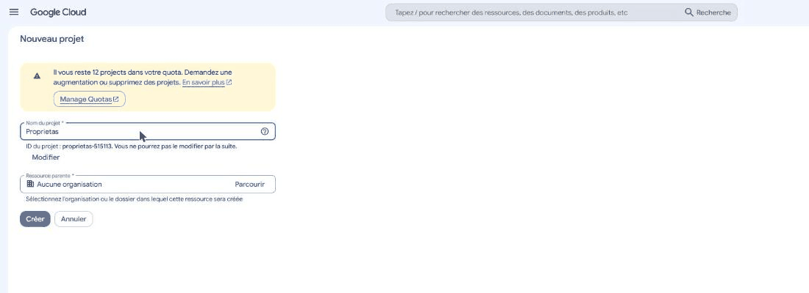

### 2. Autoriser l'accès à Google Drive

Dans la barre de recherche en haut, tapez **Google Drive API**, ouvrez-la et cliquez **Activer**.

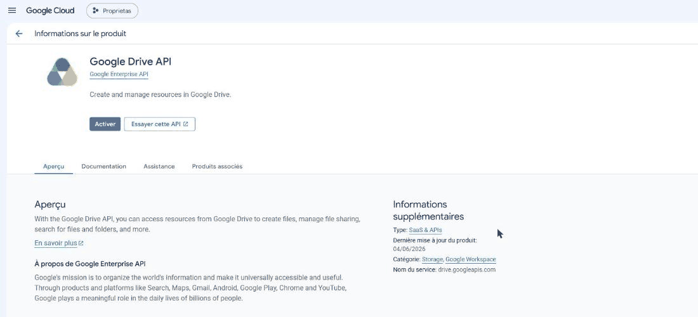

### 3. Décrire l'application (ce que verra le syndic)

Recherchez **Google Auth Platform** (ou menu ☰ → API et services → Écran de consentement OAuth), puis
**Commencer**.

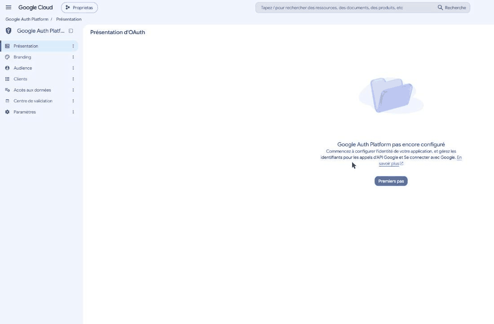

Remplissez les quatre étapes :

1. **Informations sur l'application** : nom `Proprietas`, adresse e-mail d'assistance = votre adresse.

   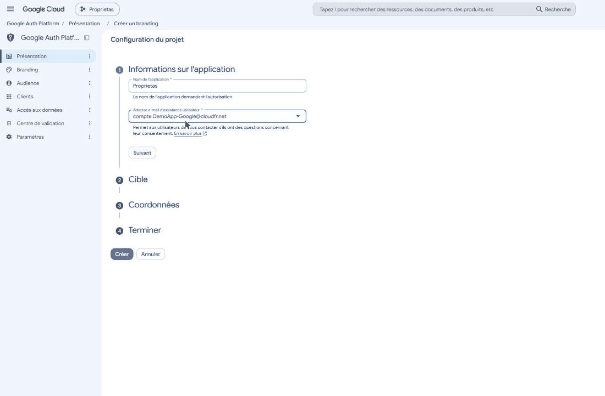

2. **Cible** : choisissez **Externe** (« Interne » ne marche qu'avec un compte Google Workspace d'entreprise,
   et seulement pour ses propres utilisateurs).

   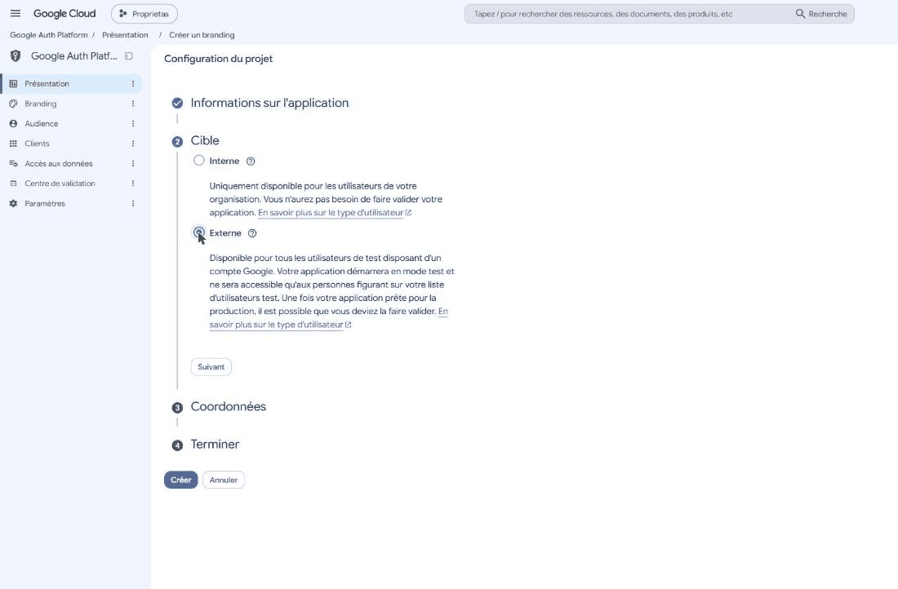

3. **Coordonnées** : votre adresse e-mail (Google vous écrira en cas de changement).

   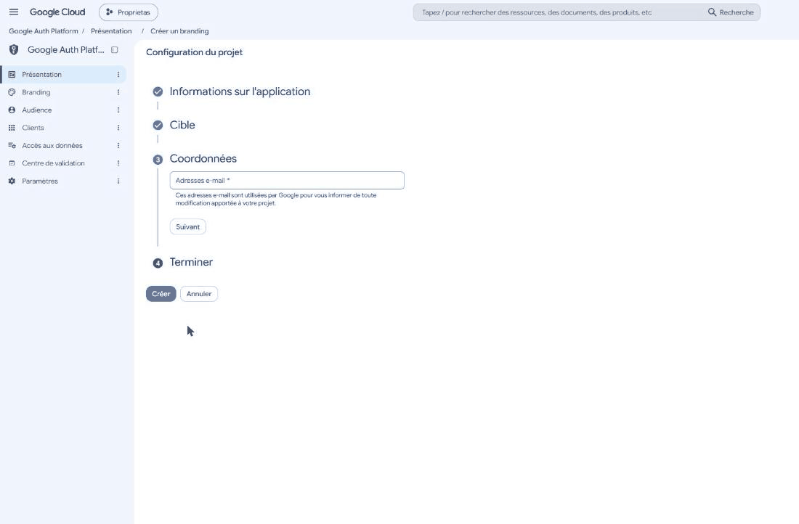

4. **Terminer** : cochez l'acceptation du règlement de Google sur les données des utilisateurs, puis
   **Continuer** et **Créer**.

   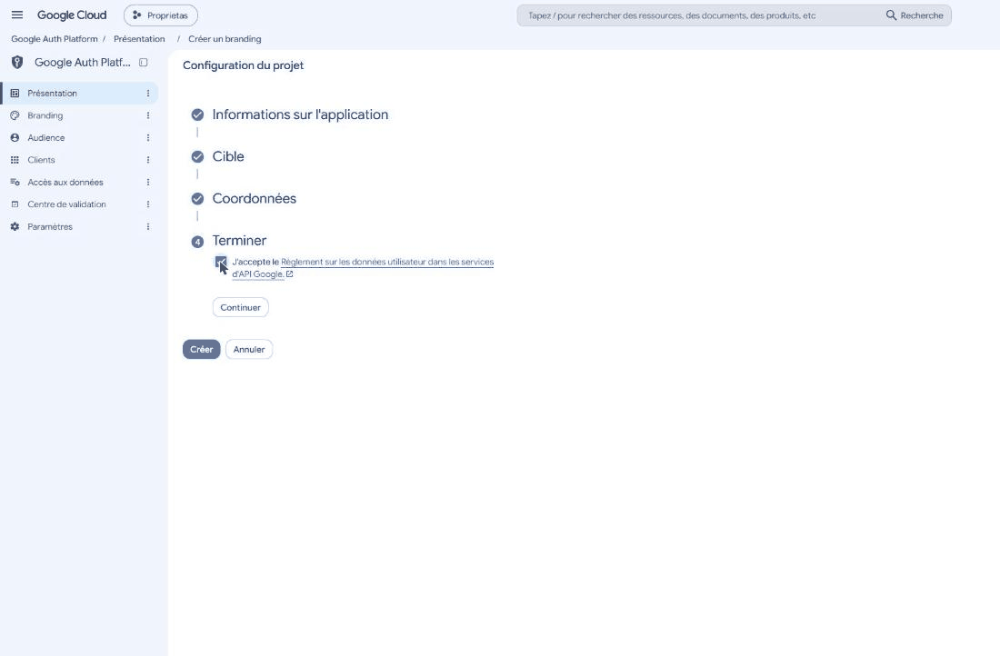

### 4. Choisir ce que Proprietas a le droit de faire

Menu de gauche **Accès aux données** → **Ajouter ou supprimer des niveaux d'accès**. Dans la liste, cochez
la ligne **Google Drive API — `.../auth/drive.file`** (« voir, modifier, créer et supprimer uniquement les
fichiers Google Drive que vous utilisez avec cette application »), **Mettre à jour**, puis **Save** en bas de
la page.

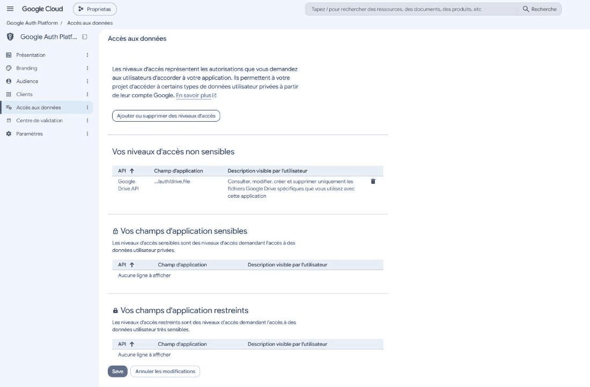

C'est l'accès le plus réduit : Proprietas ne verra jamais le reste du drive.

### 5. Indiquer qui a le droit de se connecter

Tant que l'application est « en test », **seuls les comptes Google listés ici** peuvent la brancher. Menu
**Audience** → **Utilisateurs tests** → **Add users**, saisissez l'adresse du compte Google de chaque
copropriété, puis cliquez **Save** (appuyer sur Entrée ne suffit pas : sans **Save**, rien n'est enregistré).

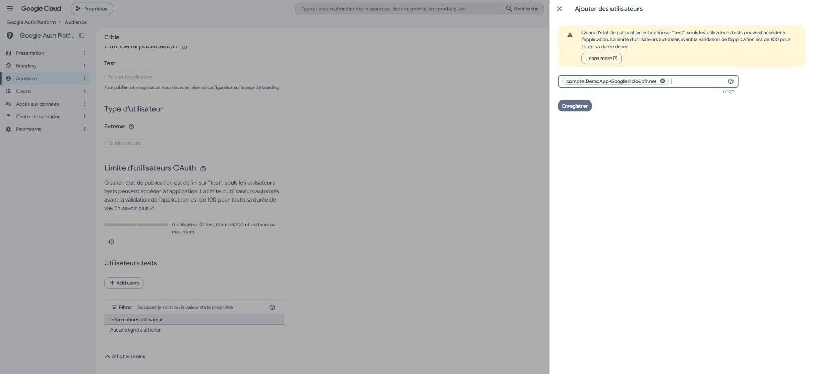

L'adresse doit ensuite apparaître dans la liste :

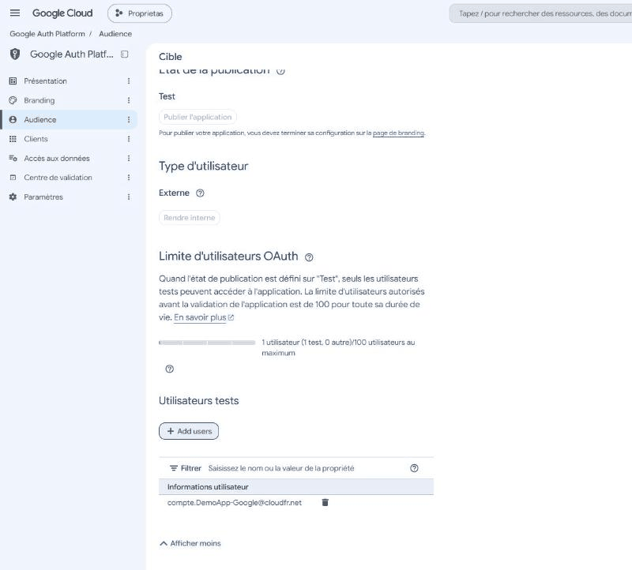

> **En test, la connexion expire au bout de 7 jours** (règle de Google) : le syndic doit alors cliquer
> **Reconnecter Google Drive**. Pour un usage durable, cliquez **Publier l'application** (menu Audience,
> après avoir complété la page **Branding**). L'accès `drive.file` n'est pas classé « sensible » par Google,
> ce qui simplifie la publication ; la liste des utilisateurs tests n'est alors plus nécessaire.

### 6. Créer les codes de connexion

Menu **Clients** → **Créer un client** :

- **Type d'application** : Application Web ;
- **Nom** : `Proprietas` (seulement pour vous) ;
- **URI de redirection autorisés** → **Ajouter un URI** : l'adresse de votre serveur suivie de
  `/api/drive/google/retour`, par exemple `https://copro.exemple.fr/api/drive/google/retour`.
  Proprietas l'affiche, prête à copier, quand on choisit Google Drive (étape 7).
  Si le serveur répond sous plusieurs noms, ajoutez une ligne par nom.

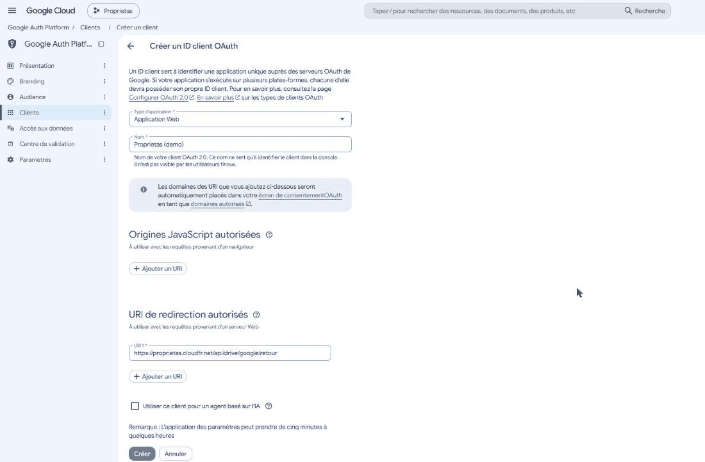

Cliquez **Créer**. Google affiche un **ID client** et un **Code secret du client** : copiez-les tout de
suite (le code secret n'est plus affiché ensuite ; sinon, il faudra en créer un nouveau).

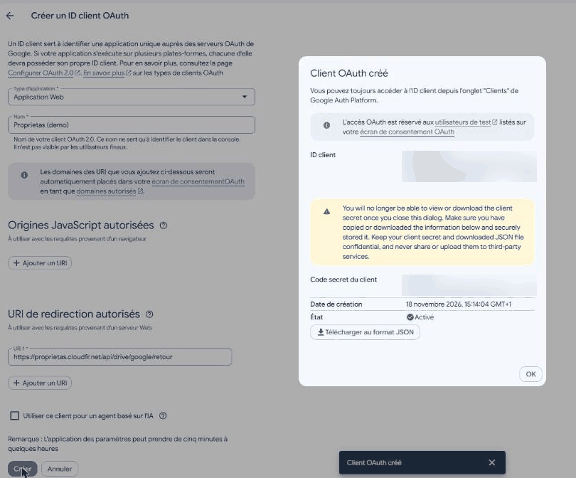

Le code secret est un mot de passe : ne le mettez ni dans un e-mail, ni dans une capture d'écran.

### 7. Donner les codes à Proprietas

Dans Proprietas : **Réglages → Sauvegarde et stockage**, carte **Drive de la copropriété**. Dans **Type de
drive**, choisissez **Google Drive**, puis collez l'**ID client** et le **Code secret du client**. Ils sont
gardés pour la copropriété (le code secret chiffré, il n'est plus jamais affiché) au moment où vous cliquez
**Se connecter à Google Drive** (partie 2).

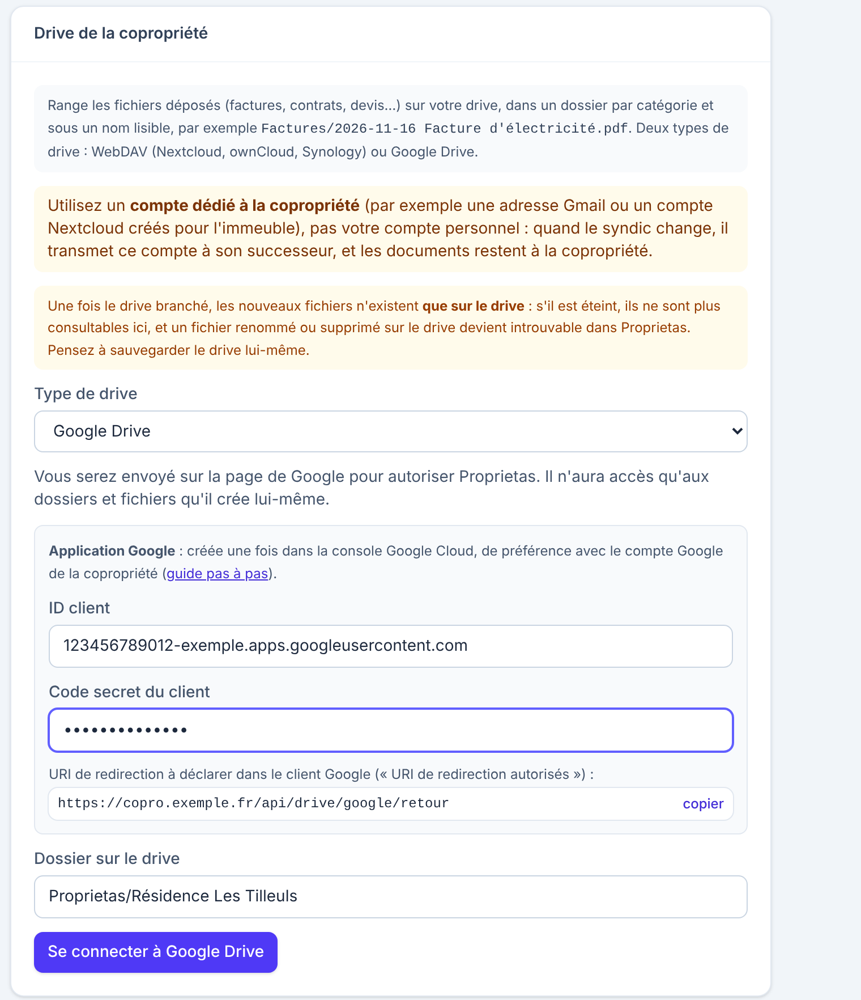

Attention à ne pas les mettre dans le type **WebDAV** : ce n'est pas le même formulaire.

**Administrateur d'un serveur à plusieurs copropriétés** : pour une seule application Google pour toutes,
ajoutez plutôt deux lignes au fichier `.env` du serveur (à côté de `docker-compose.yml`) :

```
COPRO_GOOGLE_CLIENT_ID=108360811579-xxxxxxxx.apps.googleusercontent.com
COPRO_GOOGLE_CLIENT_SECRET=GOCSPX-xxxxxxxxxxxxxxxx
```

puis `docker compose up -d`. Les syndics n'ont alors rien à saisir : ils laissent les deux champs vides. Une
copropriété qui saisit ses propres codes utilise sa propre application.

---

## Partie 2 — Le syndic branche le drive de sa copropriété (~2 minutes)

Connectez-vous d'abord, dans votre navigateur, au **compte Google dédié à la copropriété** (celui que
l'administrateur a ajouté à l'étape 5), et non à votre compte personnel.

### 1. Lancer la connexion

Dans Proprietas : **Réglages → Sauvegarde et stockage**, carte **Drive de la copropriété**, type de drive
**Google Drive** (avec les codes de l'étape 7, ou les champs vides si l'administrateur a préparé le serveur).
Le dossier proposé (`Proprietas/<nom de la copropriété>`) convient en général. Cliquez
**Se connecter à Google Drive**.

### 2. Choisir le compte Google

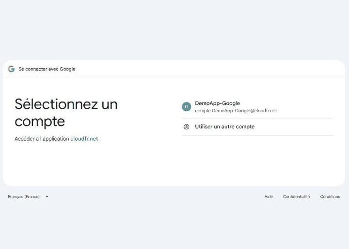

### 3. « Google n'a pas validé cette appli »

Cet avertissement s'affiche tant que l'application est en test (partie 1, étape 5). C'est normal :
cliquez **Continuer**.

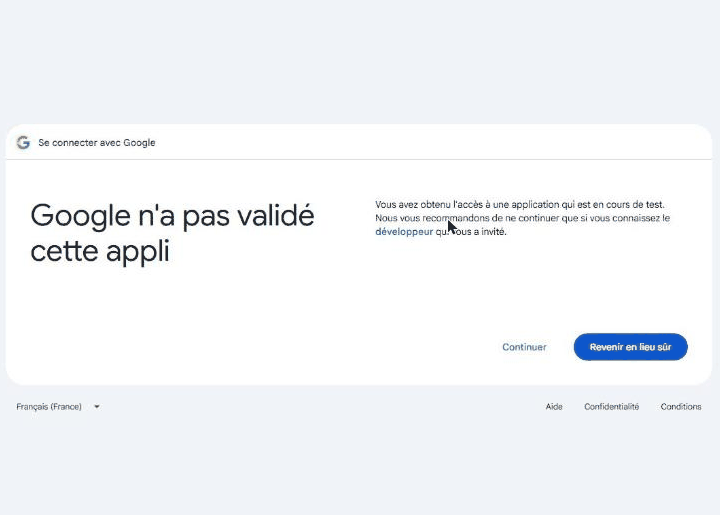

### 4. Autoriser

Google rappelle ce que Proprietas pourra faire : seulement les fichiers qu'il crée lui-même. Cliquez
**Continuer**. Google affiche le nom de domaine du serveur (ici `cloudfr.net`) tant que la page **Branding**
n'est pas complétée.

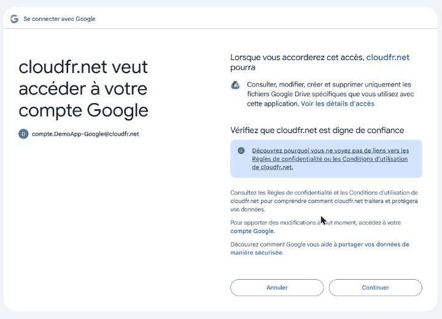

### 5. C'est branché

De retour dans Proprietas : « Drive branché », avec le compte Google utilisé. **Tester la connexion** crée
le dossier s'il n'existe pas et vérifie qu'on peut y écrire.

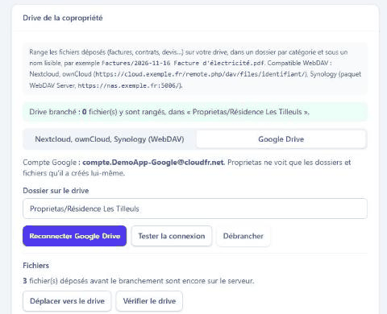

À partir de maintenant, chaque document déposé part sur le drive. Les documents déposés **avant** restent
sur le serveur : **Déplacer vers le drive** les y range aussi.

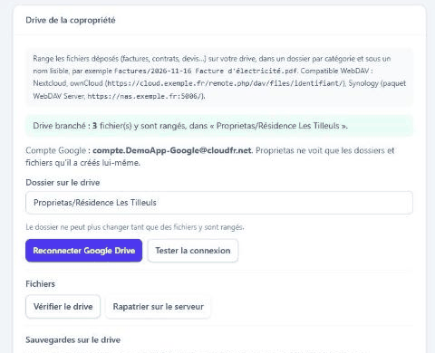

### 6. Les fichiers dans Google Drive

Sur <https://drive.google.com>, dossier **Proprietas** → nom de la copropriété : un dossier par catégorie.

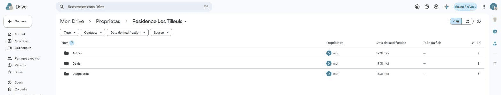

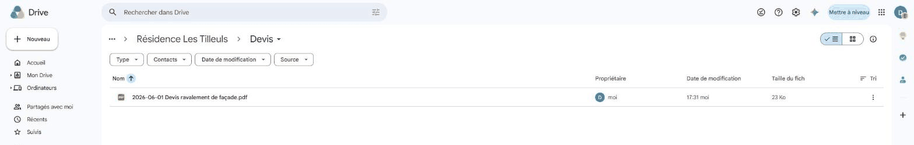

### Et ensuite

- **Sauvegardes sur le drive** (même carte) : une archive chiffrée de toute la copropriété, chaque semaine,
  dans le dossier `Sauvegardes`. Notez son mot de passe ailleurs.
- **Vérifier le drive** : signale les fichiers renommés ou supprimés à la main et propose de les retrouver.
- **Rapatrier sur le serveur** : ramène tous les fichiers sur le serveur, avant de débrancher.
- **Débrancher** : coupe le lien et retire l'autorisation chez Google. Le dossier reste sur le drive.

---

## En cas de problème

| Message | Cause | Solution |
|---|---|---|
| « Accès bloqué : … n'a pas terminé la procédure de validation de Google », erreur 403 `access_denied` | le compte Google n'est pas dans les **Utilisateurs tests** (ou l'ajout n'a pas été enregistré avec **Save**) | partie 1, étape 5 |
| erreur 400 `redirect_uri_mismatch` | l'adresse du serveur n'est pas déclarée exactement (https, nom, `/api/drive/google/retour`) | partie 1, étape 6 : ajouter l'adresse affichée par Google dans « détails de l'erreur » |
| « Indiquez l'identifiant client et le code secret de l'application Google » | aucune application : ni codes saisis pour la copropriété, ni codes dans le `.env` du serveur | partie 1, étape 7 |
| « Ce sont les codes d'une application Google » (anciennement « Réponse inattendue du drive (code 405) ») | les codes Google ont été saisis dans le type **WebDAV** | choisir **Google Drive** comme type de drive |
| « Google refuse l'application Google » | ID client ou code secret faux, ou client supprimé dans la console Google | ressaisir les deux codes (partie 1, étapes 6 et 7) |
| « reconnecter Google Drive » au bout d'une semaine | application encore en test : Google limite la connexion à 7 jours | **Reconnecter Google Drive**, ou publier l'application |

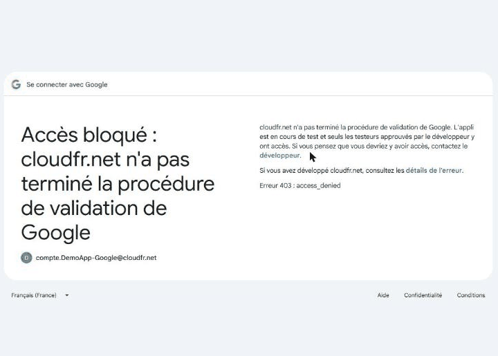

*Guide vérifié le 18 novembre 2026 sur la démo proprietas.cloudfr.net (Proprietas 2026.11.030), avec un vrai
compte Google.*
